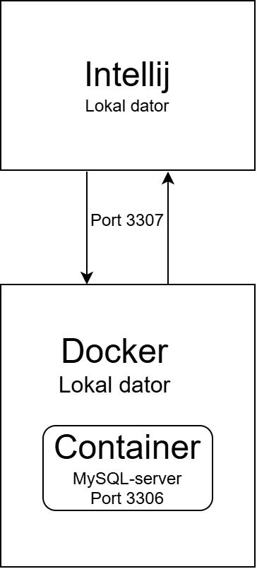

# Inlämningsuppgift 1

## Del A

### 1.
Jag använde de inbyggda funktionerna för att importera filen, men använder man terminalen så är det
de här kommandona man använder:

#För att kontrollera att containern körs.
docker ps 

#För att importera Sql-filen:
docker exec -i mysql-laboration1 mysql -u root -p < Laboration1.sql

### 2.

För moon mission är det mission_id som är primärnyckeln och för account är det user_id.

### 3.

## Del C

## 15.

SQL: Har länge haft en relationsmodell för säkra dataöverföringar, där överföringen inte
avbryts förrän det är verifierat att allt är sparat.

## 16.

NoSQL: För att man kan hantera många interaktioner på kort tid och kan lagra sessioner tidsbestämt.

## 17.

NoSQL: Med många olika attribut så blir det många tabeller eller tabeller med många kolumner,
varav en del kommer vara tomma, för att hantera det med SQL. Med MySQL så kan varje produkt
ha sin egen struktur för sin data.

## 18.

Jag har använt AI för att förtydliga någon fråga, men inte till själva koden.
Så jag har inget exempel på hur det skiljer sig mellan prompten och SQL-filen.
Men när jac skulle börja fick inget svar på den här koden, "SELECT *FROM account;"
,så då frågade jag vad det berodde på.  Jag fick då förslaget att skriva
"SELECT DATABASE();" och när det blev NULL så blev det tydligt att ingen databas var vald.
"USE laboration1;" som blev föreslaget som lösning fungerade. 😊

## 19.

För att lösenordet sparas som läsbar text i tabellen vilket gör det lätt att komma åt.
Kommer man över tabellen har man tillgång till användarid och lösenordet. Lösenordet
ska sparas säkert på något sätt, som till exempel genom att man använder en envägs
hashalgoritm.

